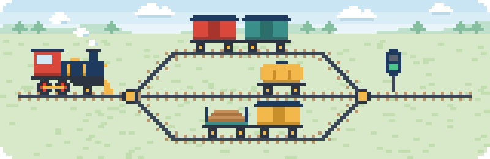
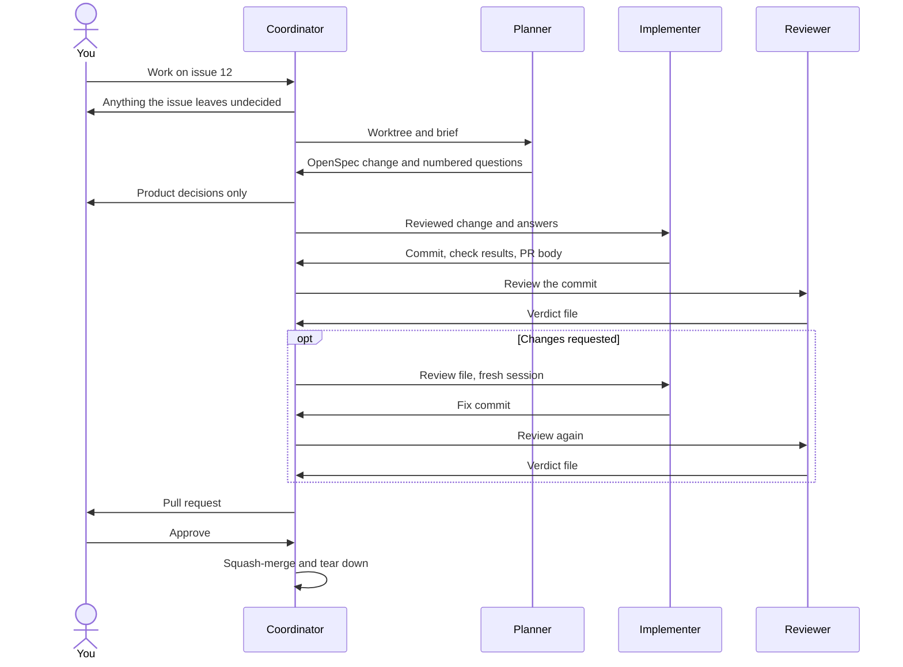

# Switchyard: an agent coordination framework



[](https://github.com/Fission-AI/OpenSpec)
[](https://claude.com/product/claude-code)
[](https://github.com/openai/codex)
[](https://opencode.ai)
[](https://herdr.dev)
[](https://cli.github.com)

Switchyard is a template repository that was born out of my own personal AI development setup.

Start a new project from it, and the project begins with a delivery workflow for coding agents already in place: issues, specs, isolated worktrees, and review gates.

It holds no application code. You add your stack on top.

One session coordinates. For each issue, a planner writes a spec change, an implementer builds it, and a reviewer on another provider checks it, in a git worktree of its own, on Claude Code, Codex, or opencode. You answer the product questions and approve the merges.

[Start a new project](#start-a-new-project) from the template, or [add the workflow to a repo you already have](#add-it-to-an-existing-repo).

## The workflow

Each piece covers a gap the others leave:

- **Issue, then spec, then code.** Every behaviour change starts as a short GitHub issue, becomes exactly one [OpenSpec](https://github.com/Fission-AI/OpenSpec) change, and ships as one PR. The PR archives the change into `openspec/specs/`, so the specs always describe what the code does.
- **Planning and building are separate sessions.** The planner runs on a strong model and stops at a plan. The implementer starts fresh on a cheaper model and reads the plan from disk. The expensive context is never carried into the cheap phase.
- **Two reviews, two reviewers.** The coordinator checks the plan before any code is written. A reviewer on a different provider from the implementer checks the diff against the change before anything is pushed.
- **Files carry every handoff.** The brief, the answers, the change, and the review live in the worktree. Each session reads them from disk, so no stage works from another session's summary, and the coordinator holds verdicts, not diffs.
- **One worktree per issue.** Each issue gets its own branch, ports, and data. Issues that own different folders run in parallel.
- **Workers never push.** Each worktree's push URL is disabled, and a script lists any file changed outside the paths the issue owns. Nothing reaches the remote until the review passes, and nothing merges until you approve it.
- **Several providers share the load.** Implementers rotate across Claude, Codex, and opencode, so one usage window does not stall a batch.

### Who does what

| Role | Where it runs | Does | Never |
|---|---|---|---|
| You | GitHub and the coordinator's chat | Open issues, answer product questions, approve merges | |
| Coordinator | Your session on the main checkout, Claude Code or Codex | Splits the work, writes briefs, reviews plans, acts on review verdicts, pushes, opens PRs, merges, cleans up | Implements |
| Planner | The issue's worktree, strong model | Reads the issue and the code, proposes the OpenSpec change, takes before screenshots, lists open questions | Writes code |
| Implementer | The same worktree, fresh session, any provider | Applies the change, runs every check, takes after screenshots, archives the change, commits, writes the PR body | Pushes |
| Reviewer | The same worktree, fresh session, a provider other than the implementer's | Checks the diff against the change's scenarios and tasks, runs every check, writes a verdict file | Edits code |

### One issue, start to finish



1. **You open an issue.** State the problem. Pick a milestone if the project uses them. Keep it short: acceptance criteria belong in the change, not the issue.
2. **You ask the coordinator to work on it.** It reads the issue against the code and asks you about anything the issue does not settle. With several issues, it splits them by the folders each one owns and runs the independent ones in parallel.
3. **The coordinator sets up.** A script creates the worktree and runs your isolation hook. The coordinator writes a brief there: the issue, the paths it owns, its ports, and the decisions so far.
4. **The planner proposes the change.** It writes the proposal, design, spec delta, and tasks under `openspec/changes/<name>`, links the change from the issue, and stops with numbered questions, each with options and a recommendation.
5. **The coordinator reviews the plan.** It checks the plan's claims against the code, answers what it can, and brings you the product decisions. The answers go into a file in the worktree.
6. **The implementer builds it.** A fresh session applies the tasks, runs every check, syncs the spec delta into `openspec/specs/`, archives the change, commits, and writes the PR body. It asks before it decides anything the plan does not cover.
7. **The reviewer checks the diff.** A fresh session on another provider reads the change and the diff. It checks each scenario and task, scope, tests, duplication, and the screenshots, runs every check, and writes a verdict to a file in the worktree.
8. **The coordinator acts on the verdict.** On a pass it pushes the branch and opens the PR. Otherwise a fresh implementer session reads the review and fixes it, and a new reviewer checks again. After two failed rounds the coordinator brings the findings to you.
9. **You approve.** The coordinator squash-merges, removes the worktree and its branch, and rebases the PRs still open.

You are asked something at three points: before work starts, after the plan, and at the merge.

## Requirements

- macOS or Linux. CI lints and tests the workflow's scripts on `ubuntu-latest`, and the maintainer develops on macOS. Windows is untested. WSL should behave like Linux, but nobody has run it.
- `git`, Python 3, and Node.js (OpenSpec runs through `npx`).
- The [GitHub CLI](https://cli.github.com), signed in.
- At least one of Claude Code, Codex, and opencode. The coordinator runs on Claude Code or Codex.
- Recommended: [Herdr](https://herdr.dev), a terminal workspace manager for coding agents. See [Runners](#runners).
- For UI screenshots: Playwright in your project, and `sips` (macOS) or ImageMagick.
- Check them with `.claude/skills/work-issues/scripts/preflight.sh`.

## Start a new project

Click **Use this template** on GitHub, or run:

```sh
gh repo create my-project --template nicoleman0/switchyard --private --clone
cd my-project
```

The new repo has every file here and none of this repo's history. Then [make it yours](#make-it-yours) before the first issue.

## Add it to an existing repo

From a clone of this repo beside yours:

```sh
mkdir -p .claude/agents .claude/skills .github/workflows
cp -R ../switchyard/.claude/agents/. .claude/agents/
cp -R ../switchyard/.claude/skills/work-issues .claude/skills/
cp ../switchyard/.github/workflows/switchyard.yml .github/workflows/
npx @fission-ai/openspec init --tools claude,codex,opencode
```

Then merge in the Workflow and Writing sections of `AGENTS.md`, the `.claude` lines of `.gitignore`, and the `rules` in `openspec/config.yaml`.

## Make it yours

| Edit | What goes there |
|---|---|
| `README.md` | This guide describes the workflow, not your project. Keep it with `git mv README.md docs/WORKFLOW.md` (after `mkdir docs`), then write your own README. |
| `LICENSE` | Replace it with your project's license, or delete it. |
| `CHANGELOG.md`, `docs/switchyard.svg`, `docs/social-preview.png`, `docs/pixelart.py` | Switchyard's release notes, banner, social preview image, and the script that draws both. Start your own changelog. Delete the three files and the banner's line at the top of the guide. |
| `CONTRIBUTING.md` | Switchyard's contributing guide. Replace it with your own, or delete it. |
| `.github/workflows/` | `switchyard.yml` checks the workflow's own files and follows releases. Put your project's checks in a workflow of their own, such as `ci.yml`. |
| `AGENTS.md`, Project section | Your checks, shared services, and conventions. Every agent reads it. |
| `openspec/config.yaml`, `context` | What the product is and what is out of scope. |
| `.claude/skills/work-issues/hooks/worktree-up.sh` and `worktree-down.sh` | Per-issue isolation: ports, a database per issue, dependency install. What `worktree-up.sh` prints lands in each brief. |
| `.claude/skills/work-issues/brief-template.md`, Isolation section | Rules every worker must follow, such as how to start a dev server on its own port. |
| `.claude/skills/work-issues/scripts/shots.mjs` | The routes to screenshot, if the project has a UI. |

Models and effort are set in two places: the routing table in `.claude/skills/work-issues/SKILL.md` and the Claude profiles in `.claude/agents/`. Change them there to use other models or fewer providers.

A Codex coordinator needs a one-time profile. The skill's "Codex coordinator profile" section has the file.

## Take a later release

Start from a clean checkout on a new branch, then run:

```sh
git switch -c update-switchyard
python3 .claude/skills/work-issues/scripts/update-switchyard.py
```

Projects made from 0.1.0 or 0.2.0 do not have the updater or a `VERSION` file. Clone Switchyard beside the project and run its updater from the project directory. Pass the release the project started from; use the oldest release if you are unsure:

```sh
git clone https://github.com/nicoleman0/switchyard.git ../switchyard
python3 ../switchyard/.claude/skills/work-issues/scripts/update-switchyard.py \
  --source ../switchyard --from 0.1.0
```

The report lists files as `added`, `updated`, `removed`, `merged`, `conflict`, or `kept`. Review the diff and resolve conflict markers. The updater does not commit. To undo, restore changed and removed files with `git restore .`, remove files reported as added, and remove `VERSION` if the project did not have one before the update.

The updater covers paths listed in its target release. It skips OpenSpec-generated files, which `npx @fission-ai/openspec update` refreshes, and Switchyard's README, license, changelog, contributing guide, and banner. See the [Switchyard releases](https://github.com/nicoleman0/switchyard/releases) for release notes.

The updater clones the release source, so a Codex session needs network access. Run it outside the sandbox if the session cannot access the network.

## Use it

1. Create an issue. Add `--milestone` if the project uses milestones:
   ```sh
   gh issue create --title "Password reset emails arrive twice" --body "..."
   ```
2. Start the coordinator on the main checkout. Open `claude` there, inside Herdr if you use it. For Codex, run `codex -p coordinator --add-dir <worktrees folder>`; the runner file names the folder.
3. Tell it what to deliver:
   - "Work on issue #12."
   - "Work on #12, #14, and #15."
   - "Run the next steps of milestone M2."
   - "Put #14 on Codex."
4. See the batch with `python3 .claude/skills/work-issues/scripts/state.py status`.
5. Answer its questions, review the PR it opens, and tell it to merge.

`AGENTS.md` tells any session asked to deliver issues to act as the coordinator and follow the skill, so there is nothing to invoke by name.

Not everything needs the crew:

- An idea that is still vague: `/opsx:explore`.
- One change you want to drive yourself: `/opsx:propose`, `/opsx:apply`, `/opsx:archive` in a single session.
- Work that changes no observable behaviour, such as tooling, refactors, or a bug where the code diverges from the spec: an issue and a PR, with no OpenSpec change.

## Runners

The runner is how the coordinator starts a worker, prompts it, waits for it, and reads its report. The coordinator picks one by checking whether it runs inside Herdr.

| | Herdr (recommended) | Headless |
|---|---|---|
| Needs | Herdr | Nothing beyond the worker CLIs |
| Workers | Interactive agents, one pane per issue | One CLI command per turn: `claude -p`, `codex exec`, `opencode run` |
| Watching | Live. You can read a pane or type into it. | Each turn's output is logged to `.claude/turns/` in the worktree. |
| Worktrees | `~/.herdr/worktrees/<repo>` | `../<repo>.worktrees/<branch>` |

The commands are in `.claude/skills/work-issues/runners/`.

## Layout

```
AGENTS.md                        rules every agent reads
CHANGELOG.md                     what changed in each release
CONTRIBUTING.md                  how to contribute to Switchyard
.github/
  workflows/switchyard.yml       checks on the workflow's own files
  ISSUE_TEMPLATE/                the short issue the workflow starts from
openspec/
  config.yaml                    project context and artifact rules
  specs/                         what the product does today
  changes/                       one folder per change in flight, plus archive/
.claude/
  agents/                        Claude profiles: model and effort for each role
  skills/work-issues/
    SKILL.md                     the coordinator's playbook and the routing table
    roles/                       planner, implementer, and reviewer instructions, shared by every provider
    runners/                     Herdr and headless commands
    hooks/                       your per-issue isolation
    brief-template.md            what each worker is told
    scripts/                     batch state, worktree setup and teardown, screenshots, merge helpers
    VERSION                      Switchyard release the workflow files follow
    update-paths.txt             files brought forward by the release updater
  skills/openspec-*, commands/   generated by OpenSpec
.agents/, .opencode/             the same OpenSpec workflows for Codex and opencode
```

`npx @fission-ai/openspec update` refreshes the generated files.

## License

MIT. See [LICENSE](LICENSE).
